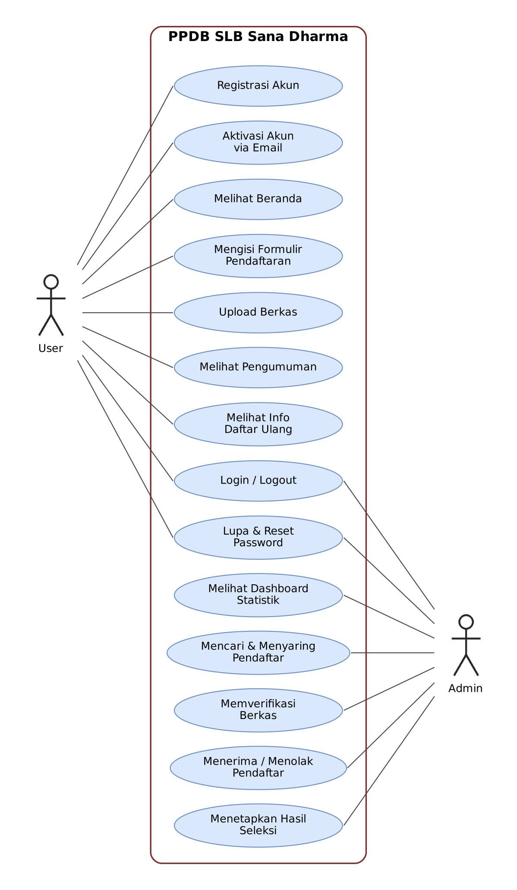

**Matriks Hak Akses dan Fitur Berdasarkan Role Pengguna**

| **No** | **Aktivitas** | **User** | **Admin** |
| ------ | ------------------------------------- | --------------------- | --------- |
| 1 | Registrasi Akun | ✓ | \- |
| 2 | Aktivasi Akun via Email | ✓ | \- |
| 3 | Login / Logout | ✓ | ✓ |
| 4 | Lupa & Reset Password | ✓ | ✓ |
| 5 | Melihat Beranda (progress & status) | ✓ | \- |
| 6 | Mengisi Formulir Pendaftaran | ✓ | \- |
| 7 | Upload Berkas | ✓ | \- |
| 8 | Melihat Pengumuman | ✓ | \- |
| 9 | Melihat Info Daftar Ulang | ✓ (hanya jika lolos) | \- |
| 10 | Melihat Dashboard Statistik | \- | ✓ |
| 11 | Mencari & Menyaring Pendaftar | \- | ✓ |
| 12 | Melihat Detail & Memverifikasi Berkas | \- | ✓ |
| 13 | Menerima / Menolak Pendaftar | \- | ✓ |
| 14 | Menetapkan Hasil Seleksi | \- | ✓ |
| 15 | Menerima Notifikasi Email (aktivasi, verifikasi, hasil seleksi) | ✓ | \- |

Keterangan:
- **User** mencakup calon pendaftar sejak belum login, yaitu saat membuka halaman registrasi dan login, sampai sesudah login ketika mengisi formulir dan mengunggah berkas.
- Akses halaman admin dibatasi untuk akun dengan role admin. Akses halaman pendaftar dibatasi untuk pengguna yang sudah login.
- Menu Laporan, Data User, dan ekspor data milik admin tidak dicantumkan karena berada di luar ruang lingkup pengujian.

**Use Case**

Sumber diagram: [`source/usecase.dot`](source/usecase.dot) (Graphviz). Untuk membuat ulang gambar: `dot -Tpng -Gdpi=150 usecase.dot -o use-case.png` dari dalam folder `source`.
