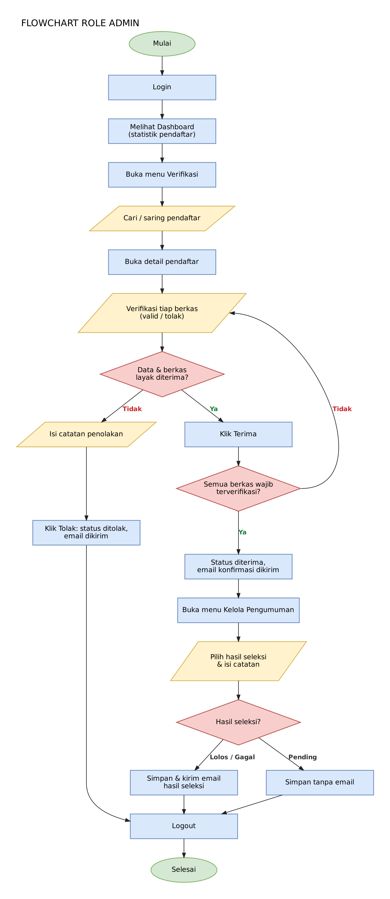

# Admin Process Flow

## Diagram Alur Proses

Berikut merupakan flowchart proses admin dalam memverifikasi pendaftar dan mengumumkan hasil seleksi pada website PPDB SLB Sana Dharma.

## Deskripsi Singkat

1. Admin memulai proses dengan login.
2. Admin melihat Dashboard yang berisi statistik pendaftar.
3. Admin membuka menu Verifikasi, lalu mencari atau menyaring pendaftar.
4. Admin membuka detail pendaftar dan memverifikasi tiap berkas (valid atau tolak).
5. Admin menilai apakah data dan berkas layak diterima.
6. Jika tidak layak, admin mengisi catatan penolakan dan mengklik Tolak. Status pendaftar menjadi ditolak dan email pemberitahuan dikirim.
7. Jika layak, admin mengklik Terima. Sistem memeriksa apakah semua berkas wajib sudah terverifikasi. Jika belum, admin kembali memverifikasi berkas.
8. Jika sudah, status pendaftar menjadi diterima dan email konfirmasi dikirim.
9. Admin membuka menu Kelola Pengumuman, memilih hasil seleksi, dan mengisi catatan.
10. Untuk hasil Lolos atau Gagal, sistem menyimpan dan mengirim email hasil seleksi. Untuk Pending, sistem hanya menyimpan tanpa mengirim email.
11. Admin melakukan logout dan proses selesai.

## Sumber Diagram

Gambar dibuat dengan Graphviz (`Admin_flowchart.dot`).
