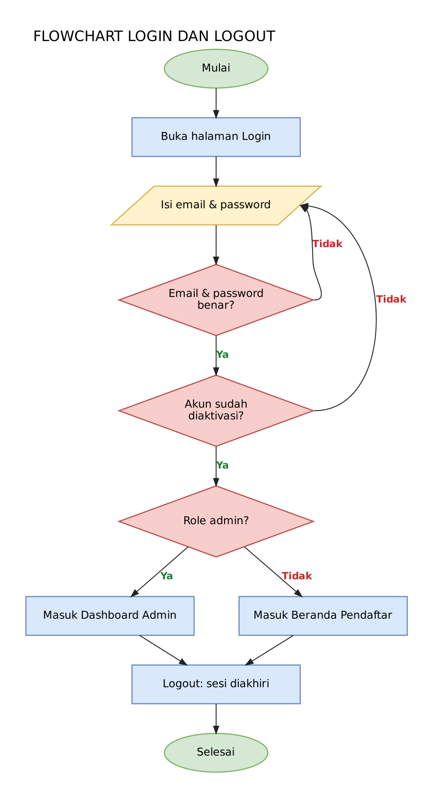

# Login dan Logout Process Flow

## Diagram Alur Proses

Berikut merupakan flowchart proses login dan logout untuk pendaftar maupun admin pada website PPDB SLB Sana Dharma.

## Deskripsi Singkat

1. Pengguna membuka halaman login.
2. Pengguna memasukkan email dan password.
3. Sistem memeriksa email dan password. Jika salah, muncul pesan "Email atau password salah!" dan pengguna kembali mengisi data login.
4. Jika benar, sistem memeriksa apakah akun sudah diaktivasi. Jika belum, muncul pesan bahwa akun belum diaktivasi dan pengguna kembali ke form login.
5. Jika akun aktif, sistem memeriksa role pengguna.
6. Admin diarahkan ke Dashboard Admin, sedangkan pendaftar diarahkan ke Beranda Pendaftar.
7. Setelah selesai, pengguna memilih Logout. Sistem mengakhiri sesi dan proses selesai.

## Sumber Diagram

Gambar dibuat dengan Graphviz (`Login_flowchart.dot`).
