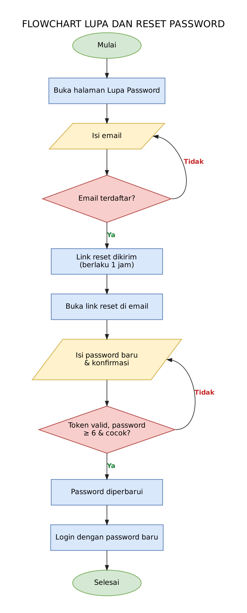

# Lupa Password Process Flow

## Diagram Alur Proses

Berikut merupakan flowchart proses lupa password dan reset password pada website PPDB SLB Sana Dharma.

## Deskripsi Singkat

1. Pengguna membuka halaman Lupa Password.
2. Pengguna memasukkan email.
3. Sistem memeriksa apakah email terdaftar. Jika tidak, muncul pesan bahwa email tidak terdaftar dan pengguna kembali mengisi email.
4. Jika terdaftar, sistem mengirim link reset password ke email. Link berlaku 1 jam.
5. Pengguna membuka link reset dari email.
6. Pengguna mengisi password baru dan konfirmasinya.
7. Sistem memeriksa apakah token masih valid, password minimal 6 karakter, dan konfirmasi cocok. Jika tidak, muncul pesan kesalahan dan pengguna kembali mengisi password baru.
8. Jika valid, password diperbarui.
9. Pengguna login dengan password baru dan proses selesai.

## Sumber Diagram

Gambar dibuat dengan Graphviz (`Lupa_Password_flowchart.dot`).
