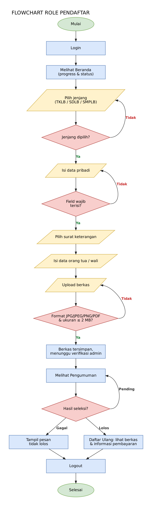

# Pendaftar Process Flow

## Diagram Alur Proses

Berikut merupakan flowchart proses pendaftar dalam mengisi formulir, mengunggah berkas, melihat pengumuman, dan melakukan daftar ulang pada website PPDB SLB Sana Dharma.

## Deskripsi Singkat

1. Pendaftar memulai proses dengan login.
2. Pendaftar melihat Beranda yang berisi progress dan status pendaftaran.
3. Pendaftar memilih jenjang pendidikan (TKLB, SDLB, atau SMPLB). Jika belum memilih, pendaftar tidak bisa lanjut ke langkah berikutnya.
4. Pendaftar mengisi data pribadi. Jika field wajib belum terisi, pendaftar harus melengkapinya terlebih dahulu.
5. Pendaftar memilih surat keterangan yang dimiliki.
6. Pendaftar mengisi data orang tua atau wali.
7. Pendaftar mengunggah berkas. Sistem hanya menerima berkas JPG, JPEG, PNG, atau PDF dengan ukuran maksimal 2 MB. Jika tidak sesuai, pendaftar mengunggah ulang.
8. Berkas tersimpan dan menunggu verifikasi admin.
9. Pendaftar melihat pengumuman. Jika hasil seleksi masih Pending, pendaftar kembali memantau pengumuman.
10. Jika hasilnya Gagal, sistem menampilkan pesan tidak lolos.
11. Jika hasilnya Lolos, pendaftar membuka Daftar Ulang untuk melihat berkas yang harus dibawa dan informasi pembayaran.
12. Pendaftar melakukan logout dan proses selesai.
    
