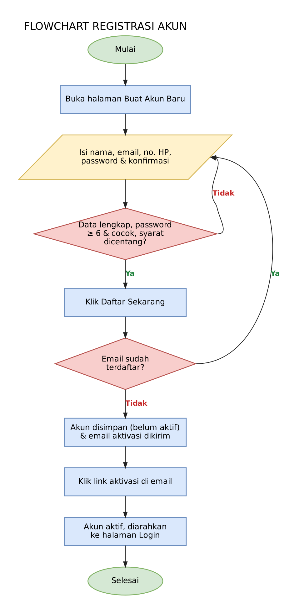

# Registrasi Akun Process Flow

## Diagram Alur Proses

Berikut merupakan flowchart proses user dalam membuat akun baru dan mengaktifkannya melalui email pada website PPDB SLB Sana Dharma.

## Deskripsi Singkat

1. User membuka halaman Buat Akun Baru.
2. User mengisi nama lengkap, email, nomor HP, password, dan konfirmasi password.
3. Sistem memeriksa apakah semua field sudah terisi, password minimal 6 karakter, konfirmasi password sama, dan kotak persetujuan Syarat dan Ketentuan sudah dicentang. Jika belum, tombol Daftar Sekarang tetap nonaktif dan user kembali melengkapi form.
4. Jika sudah memenuhi syarat, user mengklik Daftar Sekarang.
5. Sistem memeriksa apakah email sudah terdaftar. Jika sudah, muncul pesan "Email sudah terdaftar!" dan user kembali ke form.
6. Jika email belum terdaftar, sistem menyimpan akun dengan status belum aktif dan mengirim link aktivasi ke email.
7. User membuka email dan mengklik link aktivasi.
8. Sistem mengaktifkan akun dan mengarahkan user ke halaman login. Proses selesai.
