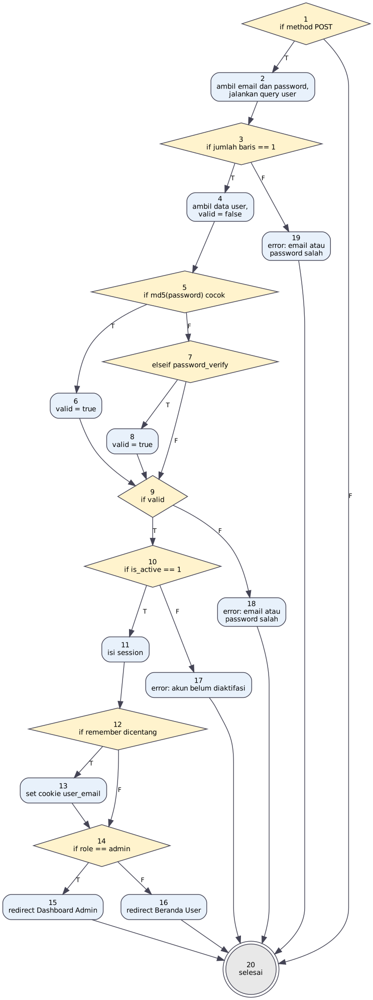
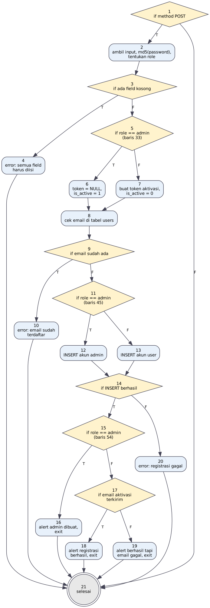
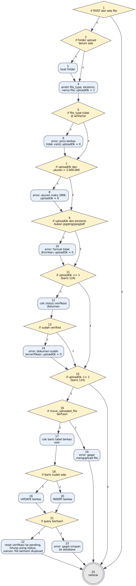
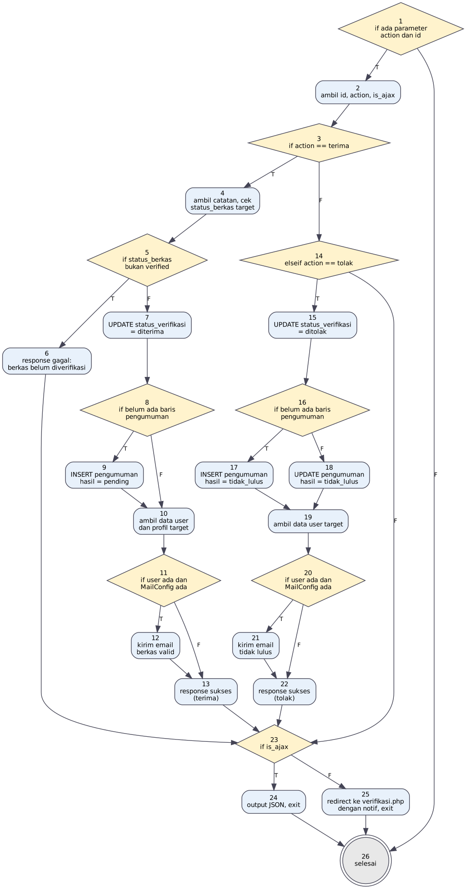
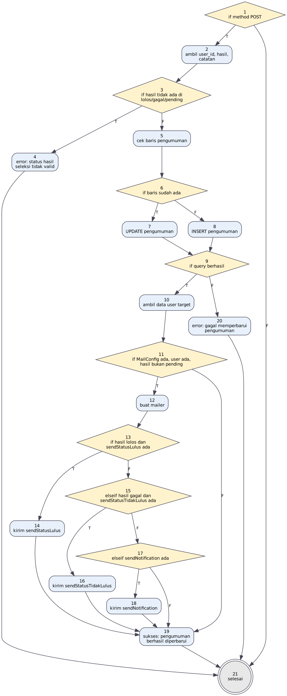

# White-box Testing (Basis Path)

Penanggung jawab: Gunawan Wibisono. Objek: website PPDB SLB Sana Dharma, commit `70a38d9`, lima unit kode pada fitur utama.

## Cara pengujian

1. Pilih satu blok kode yang berisi pengambilan keputusan (if, elseif).
2. Gambar flow graph: tiap pernyataan atau kelompok pernyataan jadi satu simpul, tiap if jadi simpul keputusan.
3. Hitung Cyclomatic Complexity V(G) dengan tiga cara dan pastikan hasilnya sama:
   - Jumlah region pada flow graph (daerah tertutup ditambah daerah luar).
   - V(G) = E - N + 2, dengan E jumlah sisi dan N jumlah simpul.
   - V(G) = P + 1, dengan P jumlah simpul keputusan.
4. Susun himpunan jalur independen, satu jalur untuk tiap keputusan yang dibalik dari jalur dasar.
5. Untuk tiap jalur, tentukan data uji dan hasil yang diharapkan, jalankan di website, catat hasil aktual dan bukti.

Aturan hitung yang dipakai: satu pernyataan if atau elseif dihitung satu simpul keputusan, termasuk bila kondisinya memakai && atau ||. Operator ternary dan `??` tidak dihitung karena hanya memilih nilai. Blok try/catch tidak dihitung karena hanya menulis log.

Beberapa jalur dalam himpunan formal tidak bisa dijalankan, ada dua macam alasannya. Jalur bertanda **Tidak mungkin** secara logika tidak bisa terjadi karena beberapa kondisi membaca nilai yang sama. Jalur bertanda **Tidak dijalankan** bisa terjadi, tetapi butuh kegagalan server atau perubahan database produksi, dan itu tidak dilakukan. Keduanya tetap ditulis supaya jumlah jalur sama dengan V(G).

## Ringkasan

| Unit | Yang diuji | Berkas dan baris | Simpul (N) | Sisi (E) | Keputusan (P) | V(G) | Jalur dijalankan |
|---|---|---|---|---|---|---|---|
| WB-01 | Pemeriksaan login | `auth/login.php` baris 12-55 | 20 | 27 | 8 | 9 | 7 dari 9 |
| WB-02 | Pemeriksaan registrasi | `auth/register.php` baris 23-72 | 21 | 28 | 8 | 9 | 4 dari 9 |
| WB-03 | Pemeriksaan upload berkas | `user/upload-berkas.php` baris 94-162 | 25 | 35 | 11 | 12 | 7 dari 12 |
| WB-04 | Aksi Terima dan Tolak pendaftar | `admin/verifikasi.php` baris 22-103 | 26 | 34 | 9 | 10 | 8 dari 10 |
| WB-05 | Penyimpanan hasil seleksi | `admin/pengumuman.php` baris 18-66 | 21 | 28 | 8 | 9 | 6 dari 9 |

## WB-01 - Pemeriksaan login

Sumber: `auth/login.php`, baris 12-55.

**Flow graph**

**Cyclomatic Complexity**

| Cara hitung | Perhitungan | Hasil |
|---|---|---|
| Region | Region pada flow graph (dihitung dari embedding planar graph) | 9 |
| E - N + 2 | 27 - 20 + 2 | 9 |
| P + 1 | 8 + 1 | 9 |

V(G) = **9**, jadi himpunan jalur independen berisi 9 jalur.

**Jalur independen dan test case**

| Jalur | Rangkaian simpul | Skenario dan data uji | Hasil diharapkan | Cara | Keterangan |
|---|---|---|---|---|---|
| WB-01-J1 | 1 - 20 | Buka halaman login tanpa mengirim form (method GET). | Form login tampil. | UI |  |
| WB-01-J2 | Login dengan email yang belum terdaftar menampilkan 'Email atau password salah!'. | Pass | Bukti/WB-01-J2.png |
| WB-01-J3 | Login user tanpa mencentang Ingat saya berhasil dan masuk ke user/dashboard.php. | Pass | Bukti/WB-01-J3-a-form-tanpa-ingat-saya.png, WB-01-J3.png |
| WB-01-J4 | 1 - 2 - 3 - 4 - 5 - 6 - 9 - 10 - 11 - 12 - 14 - 15 - 20 | Login akun admin, 'Ingat saya' tidak dicentang. | Masuk ke Dashboard Admin. | UI | Sama dengan TC-AU-18. |
| WB-01-J5 | Pada kunjungan berikutnya halaman login menampilkan email terisi otomatis dan kotak Ingat saya tercentang, tanda cookie user_email dibuat saat login sebelumnya dengan Ingat saya. Bukti tidak langsung. | Pass | Bukti/WB-01-J8.png, WB-01-J4-a-form-admin.png |
| WB-01-J6 | 1 - 2 - 3 - 4 - 5 - 6 - 9 - 10 - 17 - 20 | Login akun user yang belum aktif dengan password benar. | Pesan 'Akun belum diaktifasi. Silakan cek email Anda.' | UI | Sama dengan TC-AU-22. |
| WB-01-J7 | 1 - 2 - 3 - 4 - 5 - 7 - 8 - 9 - 10 - 11 - 12 - 14 - 16 - 20 | Login dengan akun yang password-nya disimpan sebagai hash password_hash (bukan MD5). | Login berhasil lewat cabang password_verify. | Tidak dijalankan | Semua akun dibuat lewat registrasi dan memakai MD5. Membuat hash lain berarti mengubah database produksi. |
| WB-01-J8 | Login dengan email terdaftar dan password salah menampilkan 'Email atau password salah!' dan tetap di halaman login. | Pass | Bukti/WB-01-J8.png |
| WB-01-J9 | 1 - 2 - 3 - 4 - 5 - 6 - 9 - 18 - 20 | MD5 cocok tetapi valid tetap false. | - | Tidak mungkin | Setelah MD5 cocok, valid selalu diisi true. Jalur ini ada di graph tetapi tidak bisa terjadi. |

**Hasil pelaksanaan**

| Jalur | Hasil aktual | Status | Bukti |
|---|---|---|---|
| WB-01-J1 | Form login tampil. | Pass | Bukti/WB-01-J1.png |
| WB-01-J2 | Login dengan email yang belum terdaftar menampilkan 'Email atau password salah!'. | Pass | Bukti/WB-01-J2.png |
| WB-01-J3 | Login user tanpa mencentang Ingat saya berhasil dan masuk ke user/dashboard.php. | Pass | Bukti/WB-01-J3-a-form-tanpa-ingat-saya.png, WB-01-J3.png |
| WB-01-J4 | Login admin berhasil dan masuk ke admin/dashboard.php. | Pass | Bukti/WB-01-J4-a-form-admin.png, WB-01-J4.png |
| WB-01-J5 | Pada kunjungan berikutnya halaman login menampilkan email terisi otomatis dan kotak Ingat saya tercentang, tanda cookie user_email dibuat saat login sebelumnya dengan Ingat saya. Bukti tidak langsung. | Pass | Bukti/WB-01-J8.png, WB-01-J4-a-form-admin.png |
| WB-01-J6 | Pesan 'Akun belum diaktifasi. Silakan cek email Anda.' tampil. Banner hijau 'Registrasi berhasil!' ikut tampil karena URL masih memuat registered=success (temuan T-1). | Pass | Bukti/WB-01-J6.png |
| WB-01-J7 | Tidak dijalankan | - | - |
| WB-01-J8 | Login dengan email terdaftar dan password salah menampilkan 'Email atau password salah!' dan tetap di halaman login. | Pass | Bukti/WB-01-J8.png |
| WB-01-J9 | Tidak mungkin | - | - |

## WB-02 - Pemeriksaan registrasi

Sumber: `auth/register.php`, baris 23-72.

**Flow graph**

**Cyclomatic Complexity**

| Cara hitung | Perhitungan | Hasil |
|---|---|---|
| Region | Region pada flow graph (dihitung dari embedding planar graph) | 9 |
| E - N + 2 | 28 - 21 + 2 | 9 |
| P + 1 | 8 + 1 | 9 |

V(G) = **9**, jadi himpunan jalur independen berisi 9 jalur.

**Jalur independen dan test case**

| Jalur | Rangkaian simpul | Skenario dan data uji | Hasil diharapkan | Cara | Keterangan |
|---|---|---|---|---|---|
| WB-02-J1 | 1 - 21 | Buka halaman registrasi tanpa mengirim form. | Form registrasi tampil. | UI |  |
| WB-02-J2 | 1 - 2 - 3 - 5 - 7 - 8 - 9 - 11 - 13 - 14 - 15 - 17 - 18 - 21 | Registrasi user dengan data valid. | Akun dibuat, email aktivasi dikirim, pesan 'Registrasi berhasil!'. | UI | Sama dengan TC-AU-01. |
| WB-02-J3 | Form dengan nama kosong tidak bisa dikirim karena tombol Daftar nonaktif (pemeriksaan di browser). Pemeriksaan di server belum diuji, jadi jalur ini belum dihitung. | Belum dijalankan | Bukti/WB-02-J3-ui-tombol-nonaktif.png |
| WB-02-J4 | 1 - 2 - 3 - 5 - 7 - 8 - 9 - 10 - 21 | Registrasi dengan email yang sudah terdaftar. | Pesan 'Email sudah terdaftar!'. | UI | Sama dengan TC-AU-02. |
| WB-02-J5 | 1 - 2 - 3 - 5 - 7 - 8 - 9 - 11 - 13 - 14 - 20 - 21 | INSERT ke tabel users gagal. | Pesan 'Registrasi gagal: ...'. | Tidak dijalankan | Butuh error database. Tidak dipaksakan di sistem produksi. |
| WB-02-J6 | 1 - 2 - 3 - 5 - 7 - 8 - 9 - 11 - 13 - 14 - 15 - 17 - 19 - 21 | Registrasi berhasil tetapi email aktivasi gagal terkirim. | Pesan 'Registrasi berhasil, tetapi gagal mengirim email...'. | Tidak dijalankan | Butuh SMTP gagal. Catat saja jika terjadi sendiri saat J2. |
| WB-02-J7 | 1 - 2 - 3 - 5 - 6 - 8 - 9 - 11 - 13 - 14 - 15 - 17 - 18 - 21 | Hanya kondisi role == admin pada baris 33 yang berubah. | - | Tidak mungkin | Tiga pemeriksaan role (baris 33, 45, 54) membaca nilai yang sama, jadi tidak bisa berbeda sendiri-sendiri. |
| WB-02-J8 | 1 - 2 - 3 - 5 - 7 - 8 - 9 - 11 - 12 - 14 - 15 - 17 - 18 - 21 | Hanya kondisi role == admin pada baris 45 yang berubah. | - | Tidak mungkin | Alasan sama dengan J7. |
| WB-02-J9 | 1 - 2 - 3 - 5 - 7 - 8 - 9 - 11 - 13 - 14 - 15 - 16 - 21 | Hanya kondisi role == admin pada baris 54 yang berubah. | - | Tidak mungkin | Alasan sama dengan J7. Gabungan J7, J8, J9 adalah pembuatan akun admin lewat register.php?type=admin. |

**Hasil pelaksanaan**

| Jalur | Hasil aktual | Status | Bukti |
|---|---|---|---|
| WB-02-J1 | Form registrasi tampil. | Pass | Bukti/WB-02-J1.png |
| WB-02-J2 | Alert 'Registrasi berhasil! Silakan cek email Anda untuk aktivasi.' tampil. | Pass | Bukti/WB-02-J2.png |
| WB-02-J3 | Form dengan nama kosong tidak bisa dikirim karena tombol Daftar nonaktif (pemeriksaan di browser). Pemeriksaan di server belum diuji, jadi jalur ini belum dihitung. | Belum dijalankan | Bukti/WB-02-J3-ui-tombol-nonaktif.png |
| WB-02-J4 | Pesan 'Email sudah terdaftar!' tampil. | Pass | Bukti/WB-02-J4.png |
| WB-02-J5 | Tidak dijalankan | - | - |
| WB-02-J6 | Tidak dijalankan | - | - |
| WB-02-J7 | Tidak mungkin | - | - |
| WB-02-J8 | Tidak mungkin | - | - |
| WB-02-J9 | Tidak mungkin | - | - |

## WB-03 - Pemeriksaan upload berkas

Sumber: `user/upload-berkas.php`, baris 94-162.

**Flow graph**

**Cyclomatic Complexity**

| Cara hitung | Perhitungan | Hasil |
|---|---|---|
| Region | Region pada flow graph (dihitung dari embedding planar graph) | 12 |
| E - N + 2 | 35 - 25 + 2 | 12 |
| P + 1 | 11 + 1 | 12 |

V(G) = **12**, jadi himpunan jalur independen berisi 12 jalur.

**Jalur independen dan test case**

| Jalur | Rangkaian simpul | Skenario dan data uji | Hasil diharapkan | Cara | Keterangan |
|---|---|---|---|---|---|
| WB-03-J1 | 1 - 25 | Buka halaman Upload Berkas tanpa mengirim file. | Halaman tampil, tidak ada perubahan data. | UI |  |
| WB-03-J2 | 1 - 2 - 4 - 5 - 7 - 9 - 11 - 12 - 13 - 15 - 16 - 17 - 18 - 19 - 21 - 22 - 25 | Upload JPG 500 KB untuk Foto Siswa pada akun yang sudah punya baris di tabel berkas. | Pesan 'File berhasil diupload.' dan status dokumen Pending. | UI | Sesuai skenario TS-PD-08. |
| WB-03-J3 | 1 - 2 - 4 - 5 - 7 - 9 - 11 - 12 - 13 - 15 - 16 - 17 - 18 - 20 - 21 - 22 - 25 | Upload pertama kali pada akun user baru yang belum pernah mengunggah berkas. | Pesan 'File berhasil diupload.' (jalur INSERT). | UI | Gunakan akun uji yang belum pernah upload. |
| WB-03-J4 | 1 - 2 - 3 - 4 - 5 - 7 - 9 - 11 - 12 - 13 - 15 - 16 - 17 - 18 - 19 - 21 - 22 - 25 | Folder assets/uploads belum ada di server. | Folder dibuat otomatis lalu file tersimpan. | Tidak dijalankan | Folder sudah ada di server dan tidak boleh dihapus. |
| WB-03-J5 | 1 - 2 - 4 - 5 - 6 - 7 - 9 - 11 - 15 - 25 | Di DevTools ubah nilai input tersembunyi file_type menjadi 'xyz', lalu upload file JPG valid. | Pesan 'Jenis berkas tidak valid.' | DevTools |  |
| WB-03-J6 | 1 - 2 - 4 - 5 - 7 - 8 - 9 - 11 - 15 - 25 | Upload file berukuran 2.000.001 byte. | Pesan 'Ukuran file maksimal 2MB.' | UI | Sama dengan TS-PD-09. Batas lolos: 2.000.000 byte. |
| WB-03-J7 | 1 - 2 - 4 - 5 - 7 - 9 - 10 - 11 - 15 - 25 | Upload file berekstensi .gif atau .docx. | Pesan 'Hanya file JPG, JPEG, PNG & PDF yang diperbolehkan.' | UI | Sama dengan TS-PD-10. |
| WB-03-J8 | 1 - 2 - 4 - 5 - 7 - 9 - 11 - 12 - 13 - 14 - 15 - 25 | Upload ulang dokumen yang sudah diverifikasi admin. Jika tombol upload disembunyikan, kirim lewat DevTools. | Pesan 'Dokumen ini sudah terverifikasi dan tidak dapat diubah.' | UI | Butuh dokumen yang sudah ditandai verified oleh admin (koordinasi dengan Lintang). Sama dengan TS-PD-11. |
| WB-03-J9 | 1 - 2 - 4 - 5 - 7 - 9 - 11 - 12 - 13 - 15 - 16 - 24 - 25 | move_uploaded_file gagal menyimpan file. | Pesan 'Gagal mengupload file.' | Tidak dijalankan | Butuh kegagalan penyimpanan di server. |
| WB-03-J10 | 1 - 2 - 4 - 5 - 7 - 9 - 11 - 12 - 13 - 15 - 16 - 17 - 18 - 19 - 21 - 23 - 25 | Query simpan ke database gagal. | Pesan 'Gagal menyimpan ke database: ...'. | Tidak dijalankan | Butuh error database. |
| WB-03-J11 | 1 - 2 - 4 - 5 - 6 - 7 - 9 - 11 - 12 - 13 - 15 - 16 - 17 - 18 - 19 - 21 - 22 - 25 | File_type tidak valid tetapi proses tetap berlanjut ke penyimpanan. | - | Tidak mungkin | uploadOk bernilai 0 setelah file_type ditolak, jadi pemeriksaan berikutnya selalu gagal. |
| WB-03-J12 | 1 - 2 - 4 - 5 - 7 - 9 - 11 - 12 - 13 - 14 - 15 - 16 - 17 - 18 - 19 - 21 - 22 - 25 | Dokumen terverifikasi tetapi proses tetap menyimpan file. | - | Tidak mungkin | Alasan sama dengan J11. |

**Hasil pelaksanaan**

| Jalur | Hasil aktual | Status | Bukti |
|---|---|---|---|
| WB-03-J1 | Halaman Upload Berkas tampil dengan 0 dari 4 berkas. | Pass | Bukti/WB-03-J1.png |
| WB-03-J2 | Belum dijalankan. | Belum dijalankan | Bukti/WB-03-J2.png |
| WB-03-J3 | Setelah unggah pertama, Foto Siswa berstatus Menunggu Verifikasi dan jumlah berkas menjadi 1 dari 4. Pesan 'File berhasil diupload.' belum tertangkap. | Pass | Bukti/WB-03-J3.png |
| WB-03-J4 | Tidak dijalankan | - | - |
| WB-03-J5 | Belum dijalankan. Percobaan pertama salah mengubah nama atribut, bukan nilainya, jadi hasilnya tidak dipakai. | Belum dijalankan | Bukti/WB-03-J5.png |
| WB-03-J6 | Belum dijalankan. | Belum dijalankan | Bukti/WB-03-J6.png |
| WB-03-J7 | Belum dijalankan. | Belum dijalankan | Bukti/WB-03-J7.png |
| WB-03-J8 | Belum dijalankan. | Belum dijalankan | Bukti/WB-03-J8.png |
| WB-03-J9 | Tidak dijalankan | - | - |
| WB-03-J10 | Tidak dijalankan | - | - |
| WB-03-J11 | Tidak mungkin | - | - |
| WB-03-J12 | Tidak mungkin | - | - |

## WB-04 - Aksi Terima dan Tolak pendaftar

Sumber: `admin/verifikasi.php`, baris 22-103.

**Flow graph**

**Cyclomatic Complexity**

| Cara hitung | Perhitungan | Hasil |
|---|---|---|
| Region | Region pada flow graph (dihitung dari embedding planar graph) | 10 |
| E - N + 2 | 34 - 26 + 2 | 10 |
| P + 1 | 9 + 1 | 10 |

V(G) = **10**, jadi himpunan jalur independen berisi 10 jalur.

**Jalur independen dan test case**

| Jalur | Rangkaian simpul | Skenario dan data uji | Hasil diharapkan | Cara | Keterangan |
|---|---|---|---|---|---|
| WB-04-J1 | 1 - 26 | Buka verifikasi.php tanpa parameter action dan id. | Daftar pendaftar tampil. | UI |  |
| WB-04-J2 | 1 - 2 - 3 - 4 - 5 - 7 - 8 - 9 - 10 - 11 - 12 - 13 - 23 - 25 - 26 | Login admin, buka URL .../admin/verifikasi.php?action=terima&id=ID_AKUN_UJI. Akun uji punya berkas verified dan belum punya baris pengumuman. | Status verifikasi menjadi diterima, baris pengumuman dibuat dengan hasil pending, email berkas valid dikirim, halaman kembali ke verifikasi dengan notifikasi sukses. | UI | Hanya pada akun uji milik tim. |
| WB-04-J3 | 1 - 2 - 3 - 4 - 5 - 6 - 23 - 25 - 26 | Terima pendaftar yang berkasnya belum semua verified. | Notifikasi gagal 'Berkas pendaftar ini belum sepenuhnya diverifikasi...' dan status tidak berubah. | UI | Sama dengan TS-AD-07. |
| WB-04-J4 | 1 - 2 - 3 - 4 - 5 - 7 - 8 - 10 - 11 - 12 - 13 - 23 - 25 - 26 | Terima pendaftar yang sudah punya baris pengumuman. | Status verifikasi diterima, hasil seleksi yang sudah ada tidak berubah. | UI | Gunakan akun uji yang hasilnya sudah pernah ditetapkan. |
| WB-04-J5 | 1 - 2 - 3 - 4 - 5 - 7 - 8 - 9 - 10 - 11 - 13 - 23 - 25 - 26 | Terima dengan data user kosong padahal berkas verified. | - | Tidak mungkin | Berkas verified hanya ada untuk user yang ada. Id tidak dikenal berhenti di J3. |
| WB-04-J6 | 1 - 2 - 3 - 14 - 15 - 16 - 17 - 19 - 20 - 21 - 22 - 23 - 25 - 26 | Tolak pendaftar yang belum punya baris pengumuman, dengan catatan. | Status ditolak, baris pengumuman dibuat dengan hasil tidak_lulus dan catatan, email tidak lulus dikirim. | UI | Sama dengan TS-AD-08. |
| WB-04-J7 | 1 - 2 - 3 - 14 - 15 - 16 - 18 - 19 - 20 - 21 - 22 - 23 - 25 - 26 | Tolak pendaftar yang sudah punya baris pengumuman (misalnya sudah berstatus lolos). | Status ditolak dan hasil di pengumuman berubah menjadi tidak_lulus. | UI | Amati juga tampilan Pengumuman di sisi user (lihat temuan W-4). |
| WB-04-J8 | 1 - 2 - 3 - 14 - 23 - 25 - 26 | Buka .../admin/verifikasi.php?action=xyz&id=ID_AKUN_UJI. | Tidak ada data yang berubah. Halaman kembali ke verifikasi dengan notifikasi. | UI | Catat apakah pesan notifikasi kosong. |
| WB-04-J9 | 1 - 2 - 3 - 14 - 15 - 16 - 17 - 19 - 20 - 22 - 23 - 25 - 26 | Tolak dengan id yang tidak ada di tabel users. | Tidak ada email terkirim, tetapi pesan tetap menyebut email dikirim. | Tidak dijalankan | Menulis baris yatim ke database produksi. |
| WB-04-J10 | 1 - 2 - 3 - 4 - 5 - 7 - 8 - 9 - 10 - 11 - 12 - 13 - 23 - 24 - 26 | Klik tombol Terima di halaman verifikasi (permintaan AJAX). | Aksi berjalan dan notifikasi tampil di halaman tanpa pindah halaman. | UI | Cek tab Network DevTools: permintaan memakai header X-Requested-With. |

**Hasil pelaksanaan**

| Jalur | Hasil aktual | Status | Bukti |
|---|---|---|---|
| WB-04-J1 | Halaman Verifikasi tampil dengan kartu ringkasan, tab filter, dan hasil pencarian. | Pass | Bukti/WB-04-J1.png |
| WB-04-J2 | Belum dijalankan. Butuh akun uji yang belum punya baris pengumuman. | Belum dijalankan | Bukti/WB-04-J2.png |
| WB-04-J3 | Belum dijalankan. Kondisi awal sudah ada (berkas belum terverifikasi), aksi dan notifikasinya belum diambil. | Belum dijalankan | Bukti/WB-04-J4-a-kondisi-awal.png |
| WB-04-J4 | Akun uji berkas 6 dari 6 terverifikasi. Setelah Terima, status menjadi Diterima, hasil seleksi LOLOS yang sudah ada tidak berubah, dan email 'Verifikasi Berkas Pendaftaran' diterima. Baris pengumuman akun ini sudah ada sejak 20/06/2026, jadi yang dijalankan J4, bukan J2. | Pass | Bukti/WB-04-J4-a-kondisi-awal.png, WB-04-J4-b-berkas-verified.png, WB-04-J4-c-status-diterima.png, WB-04-J4-d-email-berkas-valid.png |
| WB-04-J5 | Tidak mungkin | - | - |
| WB-04-J6 | Belum dijalankan. Butuh akun uji yang belum punya baris pengumuman. | Belum dijalankan | Bukti/WB-04-J6.png |
| WB-04-J7 | Status pendaftar menjadi Ditolak. Hasil Seleksi di Kelola Pengumuman tampil '--' karena belum ditetapkan, sesuai alur sistem: berkas ditolak, pendaftar memperbaiki berkas, lalu admin menetapkan hasil lolos atau gagal lewat menu Pengumuman (hasil GAGAL tampil setelah ditetapkan, lihat WB-05-J7). Empat kartu ringkasan berjumlah 28 dari 29 pendaftar karena pendaftar ini belum masuk kartu mana pun (temuan T-2). Di sisi pendaftar, halaman Upload Berkas menampilkan 'Berkas Ditolak! Silakan perbaiki dan upload ulang' beserta catatan admin pada dokumen yang ditolak. Pesan sukses dan email Tolak di sisi admin belum tertangkap. | Pass | Bukti/WB-04-J7-a-modal-tolak.png, WB-04-J7-b-pengumuman-admin.png, WB-04-J7-c-kartu-ringkasan.png, WB-04-J7-d-sisi-user-berkas-ditolak.png |
| WB-04-J8 | Belum dijalankan. | Belum dijalankan | Bukti/WB-04-J8.png |
| WB-04-J9 | Tidak dijalankan | - | - |
| WB-04-J10 | Belum dijalankan. | Belum dijalankan | Bukti/WB-04-J10.png |

## WB-05 - Penyimpanan hasil seleksi

Sumber: `admin/pengumuman.php`, baris 18-66.

**Flow graph**

**Cyclomatic Complexity**

| Cara hitung | Perhitungan | Hasil |
|---|---|---|
| Region | Region pada flow graph (dihitung dari embedding planar graph) | 9 |
| E - N + 2 | 28 - 21 + 2 | 9 |
| P + 1 | 8 + 1 | 9 |

V(G) = **9**, jadi himpunan jalur independen berisi 9 jalur.

**Jalur independen dan test case**

| Jalur | Rangkaian simpul | Skenario dan data uji | Hasil diharapkan | Cara | Keterangan |
|---|---|---|---|---|---|
| WB-05-J1 | 1 - 21 | Buka halaman Kelola Pengumuman tanpa mengirim form. | Daftar pendaftar tampil. | UI |  |
| WB-05-J2 | Hasil LOLOS disimpan untuk pendaftar yang sudah punya baris pengumuman, dan email 'Pengumuman Hasil Seleksi' berlabel DITERIMA diterima. Pesan sukses di halaman belum tertangkap. | Pass | Bukti/WB-05-J2-modal-lolos.png, WB-05-J2-b-email-lulus.png |
| WB-05-J3 | 1 - 2 - 3 - 4 - 21 | Di DevTools ubah value pada pilihan hasil seleksi menjadi 'xyz', lalu simpan. | Pesan 'Status hasil seleksi tidak valid!' dan data tidak berubah. | DevTools |  |
| WB-05-J4 | 1 - 2 - 3 - 5 - 6 - 8 - 9 - 10 - 11 - 12 - 13 - 14 - 19 - 21 | Tetapkan hasil untuk pendaftar yang belum punya baris pengumuman. | Baris pengumuman baru dibuat dan pesan sukses tampil. | UI | Pakai akun uji yang belum pernah diproses. |
| WB-05-J5 | 1 - 2 - 3 - 5 - 6 - 7 - 9 - 20 - 21 | Query simpan pengumuman gagal. | Pesan 'Gagal memperbarui pengumuman: ...'. | Tidak dijalankan | Butuh error database. |
| WB-05-J6 | 1 - 2 - 3 - 5 - 6 - 7 - 9 - 10 - 11 - 19 - 21 | Kembalikan hasil ke Pending. | Data tersimpan, tidak ada email terkirim. | UI | Sama dengan TS-AD-11. |
| WB-05-J7 | 1 - 2 - 3 - 5 - 6 - 7 - 9 - 10 - 11 - 12 - 13 - 15 - 16 - 19 - 21 | Tetapkan hasil Gagal. | Data tersimpan dan email tidak lulus dikirim. | UI | Sama dengan TS-AD-10. |
| WB-05-J8 | 1 - 2 - 3 - 5 - 6 - 7 - 9 - 10 - 11 - 12 - 13 - 15 - 17 - 18 - 19 - 21 | Hasil lolos atau gagal tetapi method khusus tidak ada, sehingga memakai sendNotification. | - | Tidak mungkin | MailConfig punya sendStatusLulus dan sendStatusTidakLulus, jadi cabang ini tidak tercapai. |
| WB-05-J9 | 1 - 2 - 3 - 5 - 6 - 7 - 9 - 10 - 11 - 12 - 13 - 15 - 17 - 19 - 21 | Tidak ada satu pun method email tersedia. | - | Tidak mungkin | Alasan sama dengan J8. |

**Hasil pelaksanaan**

| Jalur | Hasil aktual | Status | Bukti |
|---|---|---|---|
| WB-05-J1 | Halaman Kelola Pengumuman tampil. Kartu: 8 belum diumumkan, 1 dalam proses, 12 lolos, 7 tidak lolos, dari 29 pendaftar. | Pass | Bukti/WB-05-J1.png |
| WB-05-J2 | Hasil LOLOS disimpan untuk pendaftar yang sudah punya baris pengumuman, dan email 'Pengumuman Hasil Seleksi' berlabel DITERIMA diterima. Pesan sukses di halaman belum tertangkap. | Pass | Bukti/WB-05-J2-modal-lolos.png, WB-05-J2-b-email-lulus.png |
| WB-05-J3 | Belum dijalankan. | Belum dijalankan | Bukti/WB-05-J3.png |
| WB-05-J4 | Belum dijalankan. Butuh akun uji yang belum pernah diproses. | Belum dijalankan | Bukti/WB-05-J4.png |
| WB-05-J5 | Tidak dijalankan | - | - |
| WB-05-J6 | Belum dijalankan. | Belum dijalankan | Bukti/WB-05-J6.png |
| WB-05-J7 | Hasil GAGAL disimpan untuk pendaftar yang sudah punya baris pengumuman, dan email 'Pengumuman Hasil Seleksi' dengan label BELUM DITERIMA diterima. Di daftar, baris pendaftar itu kini menampilkan GAGAL (sebelumnya '--' setelah Tolak). Pesan sukses di halaman belum tertangkap. | Pass | Bukti/WB-05-J7-a-modal-gagal.png, WB-05-J7-b-email-belum-diterima.png, WB-05-J7-c-daftar-gagal.png |
| WB-05-J8 | Tidak mungkin | - | - |
| WB-05-J9 | Tidak mungkin | - | - |

## Realisasi pelaksanaan putaran 1 (24 November 2026)

Pada putaran ini yang dijalankan hanya jalur utama. Jalur lain belum dijalankan dan tidak dihitung sebagai Pass.

| Unit | Jalur yang bisa dijalankan | Sudah dijalankan | Sisa | Pass | Fail |
|---|---|---|---|---|---|
| WB-01 | 7 | 7 | 0 | 7 | 0 |
| WB-02 | 4 | 3 | 1 (J3) | 3 | 0 |
| WB-03 | 7 | 2 | 5 (J2, J5, J6, J7, J8) | 2 | 0 |
| WB-04 | 8 | 3 | 5 (J2, J3, J6, J8, J10) | 3 | 0 |
| WB-05 | 6 | 3 | 3 (J3, J4, J6) | 3 | 0 |
| Total | 32 | 18 | 14 | 18 | 0 |

Kode dibaca dari berkas sumber di GitHub (cabang main). Bukti pembacaan kode: `Bukti/WB-01-kode-a-login-baris-11-34.png`, `WB-01-kode-b-login-baris-33-55.png`, `WB-02-kode-a-register.png`, `WB-02-kode-b-register.png`, `WB-03-kode-a-upload.png`, `WB-03-kode-b-upload.png`, dan `WB-05-kode-pengumuman-baris-6-40.png`.

## Temuan dari pelaksanaan

Temuan di bawah sudah terlihat di website. Masuk ke Bug Report setelah severity ditetapkan.

| No | Jalur | Yang terlihat | Dugaan severity | Bukti |
|---|---|---|---|---|
| T-1 | WB-01-J6 | Pesan 'Akun belum diaktifasi' dan banner hijau 'Registrasi berhasil!' tampil bersamaan karena parameter registered=success masih ada di URL. Pesan saling bertentangan. | Minor | Bukti/WB-01-J6.png |
| T-2 | WB-04-J7 | Pendaftar yang berkasnya ditolak tidak masuk kartu ringkasan Kelola Pengumuman mana pun (total kartu 28 dari 29), karena hasilnya belum ditetapkan. Sesuai alur, tetapi jumlah kartu tidak sama dengan jumlah pendaftar. Hanya observasi, bukan defect bila memang disengaja. | Trivial | Bukti/WB-04-J7-b-pengumuman-admin.png, Bukti/WB-04-J7-c-kartu-ringkasan.png |
| T-3 | Detail Pendaftar | Setelah status menjadi DITERIMA, banner 'Siap diverifikasi di Halaman Verifikasi' dan tombol 'Lanjutkan ke Halaman Verifikasi' masih tampil. | Trivial | Bukti/WB-04-J4-c-status-diterima.png |
| T-4 | WB-01 | Pada URL login dengan logout=success tidak ada pesan logout. Mendukung W-6. | Minor | Bukti/WB-01-T4-logout-tanpa-pesan.png |
| T-5 | Upload Berkas (sisi pendaftar) | Indikator 'Kelengkapan Berkas Wajib' menunjukkan 4 / 4 berkas walau satu berkas wajib berstatus Ditolak. Angka menghitung berkas yang sudah diunggah, bukan yang lolos verifikasi, sehingga labelnya bisa menyesatkan. | Trivial | Bukti/WB-04-J7-d-sisi-user-berkas-ditolak.png |

## Temuan awal dari pembacaan kode

Ini dugaan dari membaca source code, belum terbukti. Masuk ke Bug Report hanya setelah dibuktikan lewat pengujian di website.

| No | Lokasi | Yang terlihat di kode | Cara membuktikan |
|---|---|---|---|
| W-1 | auth/register.php | Server hanya memeriksa field kosong. Panjang password minimal 6, kecocokan konfirmasi, dan persetujuan Syarat dan Ketentuan hanya diperiksa JavaScript di browser. | Uji lewat DevTools: hapus pembatas di browser, kirim password 3 karakter. Bandingkan dengan reset password yang memeriksa panjang di server. |
| W-2 | auth/register.php baris 25 dan 30 | Password di-md5 sebelum dicek kosong. Hasil md5 string kosong tidak kosong, jadi password kosong lolos pemeriksaan 'Semua field harus diisi!'. | Uji lewat DevTools: kirim password kosong. Seharusnya ditolak. |
| W-3 | auth/register.php baris 55 | Setelah admin baru dibuat, halaman diarahkan ke manage_users.php. Berkas itu tidak ada di folder aplikasi. | Tidak diuji (membuat akun admin di sistem produksi). Catat sebagai temuan dari kode. |
| W-4 | admin/verifikasi.php baris 79 dan 81 | Aksi Tolak menyimpan hasil_seleksi 'tidak_lulus', sedangkan menu Pengumuman hanya mengenal 'lolos', 'gagal', 'pending'. Dua menu memakai nilai berbeda untuk hal yang sama. | Amati di sisi user setelah J6 dan J7, dan di tabel Kelola Pengumuman admin. |
| W-5 | admin/verifikasi.php baris 93 | Pesan sukses Tolak selalu menyebut email notifikasi telah dikirim, tanpa melihat hasil pengiriman. | Tidak bisa dibuktikan tanpa membuat SMTP gagal. Catat saja. |
| W-6 | auth/login.php | Login tidak menampilkan pesan untuk parameter error (misalnya error=invalid_token dari aktivasi) maupun logout=success. | Amati saat TC-AU-15, TC-AU-16, dan TC-AU-24. |
| W-7 | auth/activate.php dan auth/reset-password.php | Parameter token dimasukkan ke query SQL tanpa di-escape. | Di luar ruang lingkup pengujian (keamanan). Jangan diuji, cukup disebut di laporan sebagai catatan. |

## Catatan pelaksanaan

- Semua uji hanya memakai akun uji milik tim. Jangan menyentuh data pendaftar asli dan jangan mengubah database langsung.
- Jalur bertanda DevTools dijalankan dengan Inspect Element di browser. Tujuannya menguji pemeriksaan di sisi server, bukan menyerang sistem.
- Nama berkas bukti mengikuti kolom Bukti: simpan screenshot di folder `Bukti/`.
- Password admin tidak boleh muncul di screenshot atau dokumen.
